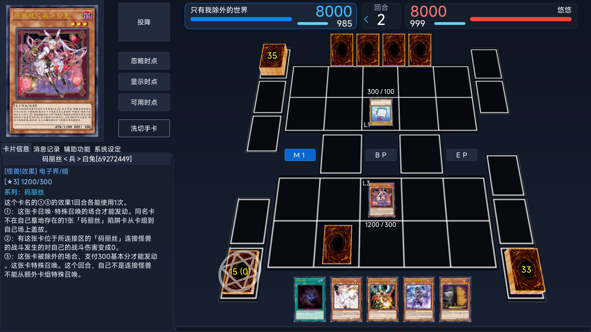

# YGOPro KoishiPro-HTmod

[](https://github.com/D1relia/ygopro-htmod/releases)
[](https://github.com/D1relia/ygopro-htmod/releases)
[](https://github.com/D1relia/ygopro-htmod)

基于 **KoishiPro** 深度定制的支持MyCard的美化与体验增强客户端。专注于**对称的 3D 对局视野**、**2K 高分屏适配**，以及绿色可逆的**简中官方译名**与**日文 / 简中双版本高清卡图**一键同步。

> 所有译名补丁与卡图资源均独立存放在 `expansions/` 目录中，**不修改萌卡原版 `cards.cdb`**，随时可一键还原。



---

## 核心特性

### 1. 3D 棋盘与现代 UI 视觉重构
- **对称棋盘视角**：重新校准 3D 棋盘相机与投影视锥参数，画面端正。
- **暗色圆角现代皮肤**：内置定制暗色圆角界面，对局中的「发动」「通常召唤」「特殊召唤」「盖放」「变更表示形式」「攻击宣言」等指令按钮按类型分色高亮。
- **内置高清字体**：打包新版静态 **MiSans** 字体（`MiSans-Medium.ttf`），高分屏下卡名与效果文本清晰锐利。

### 2. 高分屏与细节体验修复
- **2K + 200% 缩放深度适配**：修复高分辨率及高 DPI 缩放下的 HUD 文本折行、多选一效果选择框及数字宣言弹窗的按钮裁切隐患。
- **悬停光效精准对齐**：将皮肤悬停判定重构为基于引擎原生 `getHovered()`，彻底修复 2K + 200% 缩放下按钮悬停光效向上错位与弹窗穿透高亮问题。

### 3. 【安装可选】 一键同步简中官方译名（`更新简中官方译名.exe`）
- 联网同步百鸽（YGOCDB）最新简中官方译名，内置人工校对的官方字段表（`setname`）。
- 自动按同名卡组三级优先级统一**异画 / 超框卡**译名，并同步替换效果正文中的「卡名 / 字段」引用。
- 自动将卡名与文本中的异体中点（如日文片假名中点 `・`）标准化为中文间隔号 `·`，消除缺字留白，同时支持中文输入法直接输入 `·` 精准搜卡。

### 4. 【安装可选】 日文 / 简中高清卡图工具（`更新卡图.exe`）
- **双语言无痛切换**：支持 **日文 OCG 卡图** 与 **简中卡图** 自由切换。切换时自动将另一套卡图包暂存为 `.disabled`，切回时直接复用本地缓存，无需重复下载。
- **简中分层兜底策略**：简中模式优先拉取官方简中卡图（`sc`）；尚未发售简中的最新 OCG 卡包自动回退拉取百鸽高清中文图（`ygopro`）。
- **全面兼容超先行服补丁**：自动扫描外部 `.ypk` 中的数据库，并通过卡名将 **9 位先行临时卡密自动桥接至 8 位正式卡密**，以最高优先级覆盖至 `expansions/pics/`（覆写既有散图前自动备份，完全可逆）。
- **索引预检与断点续传**：同步前拉取图床 `metadata` 索引，免去无效 404 请求，支持「仅同步卡组 / 全卡池同步」、`Ctrl+C` 安全暂停续传及画质更新后的自动增量替换。

---

## 安装与使用

### 1. 下载安装包
前往本仓库右侧的 [**Releases**](https://github.com/D1relia/ygopro-htmod/releases) 页面，下载最新版本的 **`KoishiPro-HTmod-Setup.exe`**。

### 2. 运行安装向导
1. 安装前请先完全关闭萌卡（MyCard）及所有 YGOPro 游戏窗口。
2. 运行 `KoishiPro-HTmod-Setup.exe`，向导会自动检测本地萌卡的 `ygopro` 目录（若未自动识别，请手动选择包含 `ygopro.exe` 与 `cards.cdb` 的文件夹）。
3. 在**选择安装组件**页面按需勾选：
   - **主程序与 MiSans 字体**（必选）
   - **简中官方译名更新器**（可选）
   - **高清卡图替换工具**（可选，展开后可单选「日文卡图」或「简中卡图」）
4. 安装完成页默认勾选所选工具的**立即联网同步**，点击「完成」后将自动弹出终端窗口开始同步。

> **建议**：首次同步卡图时推荐先选择 `1. 仅同步 deck/ 目录中的全部卡组` 快速验证效果；确认满意后再随时双击游戏目录下的 `更新卡图.exe` 同步全卡池。

### 3. 命令行参数（可选）
除直接双击交互运行外，`更新卡图.exe` 还支持通过参数预设语言：

```powershell
# 直接进入日文卡图同步流程
.\更新卡图.exe --lang jp

# 直接进入简中卡图同步流程
.\更新卡图.exe --lang sc
```

---

## 目录结构与文件说明

安装与同步完成后，游戏目录下仅会新增/替换以下文件：

| 路径 | 说明 |
| :--- | :--- |
| `ygopro.exe` | KoishiPro-HTmod 主程序 |
| `fonts/MiSans-Medium.ttf` | 内置 MiSans 静态字体 |
| `更新简中官方译名.exe` | 简中官方译名与字段同步工具 |
| `更新卡图.exe` | 日文 / 简中 / 超先行高清卡图同步工具 |
| `expansions/sc_official.cdb` | 简中官方译名覆盖数据库（不修改原版 `cards.cdb`） |
| `expansions/strings.conf` | 简中官方字段表 |
| `expansions/jp_pics.ypk` / `sc_pics.ypk` | 日文 / 简中卡图包（未启用版本会自动后缀 `.disabled` 保留缓存） |
| `expansions/pics/` | 超先行服高优先级卡图覆盖目录（覆写前的原散图自动备份于 `expansions/_htmod_pics_backup/`） |

---

## 常见问题 (FAQ)

**Q：运行安装包或更新工具时被 Windows Defender / 杀毒软件拦截？**  
A：主程序与 Python 同步工具均由 GitHub Actions 自动编译打包，未购买商业代码签名证书。如遇 SmartScreen 提示，点击「更多信息」→「仍要运行」或添加信任即可。

**Q：萌卡更新卡池或超先行补丁后需要重新安装吗？**  
A：
- **仅更新卡池 / 超先行补丁**：直接双击游戏目录下的 `更新简中官方译名.exe` 和 `更新卡图.exe` 增量补齐新卡即可。
- **萌卡更新覆盖了 `ygopro.exe`**：重新运行一遍 `KoishiPro-HTmod-Setup.exe` 覆盖安装主程序即可，已下载的卡图包与缓存均会保留。

**Q：想在中途切换日文 / 简中卡图怎么办？**  
A：直接双击 `更新卡图.exe` 选择另一套语言即可，脚本会自动停用当前语言包并恢复/同步目标语言包，同时自动同步切换超先行覆盖图。

**Q：如何卸载或还原回原版萌卡？**  
A：删除 `expansions/` 下由本工具生成的 `sc_official.cdb`、`strings.conf`、`*_pics.ypk*` 及相关缓存文件，并在萌卡客户端中验证游戏完整性恢复原版 `ygopro.exe` 即可。

---

## 致谢

- [YGOPro](https://github.com/Fluorohydride/ygopro) / [KoishiPro](https://github.com/purerosefallen/ygopro) 开源客户端生态
- [百鸽 (YGOCDB)](https://ygocdb.com/) 提供的卡片数据库与高清卡图接口
- [MiSans](https://hyperos.mi.com/font/) 免费商用字体
