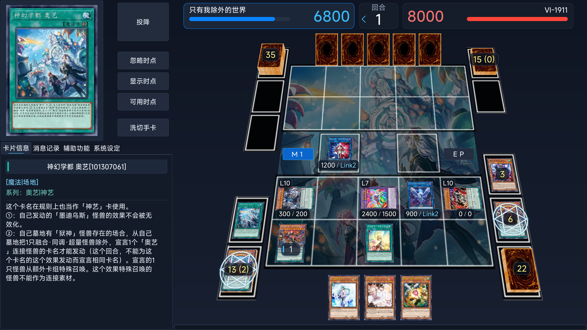
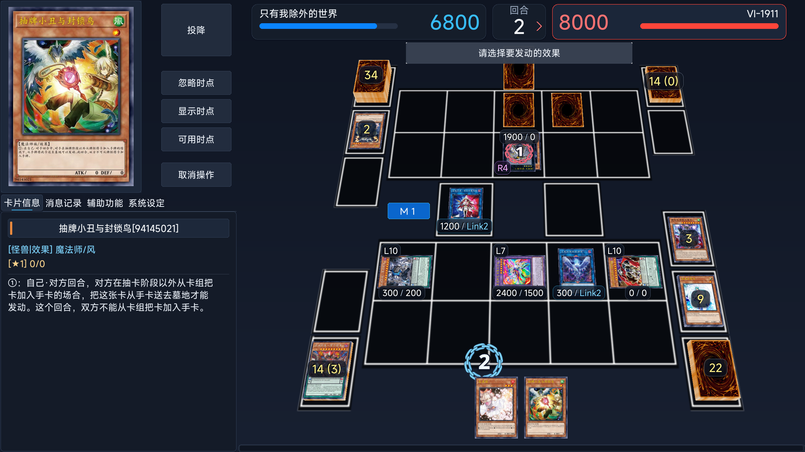

<div align="left">

# YGOPro-HTmod

基于 **YGOPro / KoishiPro** 深度优化的现代视觉与对局体验增强客户端

<p>
  <a href="https://github.com/D1relia/ygopro-htmod/releases/latest">
    
  </a>
</p>

</div>

在完整保留经典操作手感与联机兼容性的前提下，采用统一的 **暗色扁平 × 毛玻璃（Glassmorphism）** 视觉语言重构对局界面与核心贴图，面向 1080p / 2K 等高分屏场景打造清爽、护眼、贴合实卡环境的竞技打牌客户端。

安装时可选 **简中卡名替换** / **日文/简中卡图替换**。

> **当前版本：** `v1.0.1`  
> **推荐分辨率：** `1920×1080` / `2560×1440`（亦支持 `1280×720`、`1600×900` 预设一键切换）

---

## 界面预览

<!-- 建议将实机截图放入 docs/images/ 目录后替换下方路径 -->
| 对局实景 | 分色连锁 |
| :---: | :---: |
|  |  |

---

## v1.0 核心特性

### 1. 现代暗色毛玻璃界面与配色体系
全客户端统一采用克制、高对比度的现代配色方案（**亮冰蓝 `#38BDF8`**、**琥珀金 `#FBBF24`**、**珊瑚红 `#FB7185`**、**深石板灰 `#0F172A`**），告别旧版高饱和纯 RGB 色块与割裂边框：
* **顶部决斗 HUD 重制**：圆角毛玻璃 LP 卡片、己方冰蓝 / 对方珊瑚红阵营高亮、居中回合徽章与回合归属方向箭头，内置倒计时进度条与低时间预警变色。
* **系统设定与辅助面板优化**：修复页面四边留白与滚动条对齐，新增分辨率预设下拉菜单，支持现代 UI 与经典原版界面自由切换。

### 2. 场上毛玻璃信息气泡与 3D 精准贴合
彻底解决旧版白字叠卡图、跨格遮挡邻卡与魔陷区的问题：
* **攻守 / Link 值胶囊**：基于 3D 区域边缘投影精准内收锚定在卡片底边（对方为顶边）内侧，不侵占下方魔陷与邻格空间；连接怪兽采用紧凑的 `Link1`～`Link6` 显示并附带冰蓝描边，攻守增减自动以暖金 / 珊瑚红区分。
* **等级 / 阶级迷你胶囊**：精准锚定在卡片左上角内侧，超量（淡紫）、调整（暖金）、常规怪兽（冷白）自动分色。
* **双色通透灵摆刻度**：左右灵摆区改为蓝 / 红双色半透明磨砂玻璃气泡配侧边光条，避开中央卡图主体区域。
* **堆叠区计数气泡与自动避让**：主卡组、额外卡组（含表侧灵摆计数）、墓地、除外区统一使用暗灰蓝玻璃底牌，压在亮色卡图上依然清晰；当区域存在连锁环时，计数气泡自动位移避让，互不遮挡。

### 3. 场地魔法背景不透明度实时调节
针对发动场地魔法后原图直接铺满棋盘导致画面发花、格线模糊的痛点：
* 在 **「系统设定」** 中新增 **「场地不透明度」** 实时滑块（`0%`～`100%`，默认 `45%`），拖动时棋盘实时平滑融合暗色底板（支持双方不同场地拼接显示）。

### 4. 零闪烁恒亮选框与敌我红蓝分色连锁
* **去锯齿恒亮实线选框**：取消旧版跳动虚线（蚂蚁线）与高频暴闪，改为单层零深度冲突（关闭 `ZWriteEnable`）恒亮实线框，并按交互语义统一配色：
  * 选格子：**亮冰蓝**（可选）/ **青白加粗**（已选）+ 柔和半透明选位底膜；封锁格子自动切换 **珊瑚红**。
  * 选卡片 / 可发动：**暖琥珀金**（可选）/ **亮冰蓝加粗**（已选定）。
  * 鼠标悬停格：取消每帧明暗暴闪，改为静谧柔和的冰蓝半透明提示。
* **敌我红蓝分色连锁**：**己方连锁**显示为冰蓝锁链与冰白数字，**对方连锁**显示为珊瑚红锁链与柔白数字，当前栈顶结算环自动放大并提亮，多连锁博弈与复盘一目了然。

### 5. 全新高清矢量平面风核心贴图包
随安装包自动部署 5 张重绘的真透明通道 RGBA PNG 贴图，同时修复 `DrawSpec()` 弹窗对高清贴图的自适应裁切：

| 贴图文件 | 规格 | 说明 |
| :--- | :--- | :--- |
| `textures/act.png` | `512×512` RGBA | 加粗高可视冰蓝发光几何六芒星发动提示阵 |
| `textures/chain.png` | `512×512` RGBA | 加粗 8 环嵌套正圆矢量锁链（适配红蓝着色） |
| `textures/attack.png` | `512×512` RGBA | 现代扁平双色调冷银/冰蓝矢量长剑与哑光金护手 |
| `textures/negated.png` | `512×512` RGBA | 扁平珊瑚红渐变效果无效标志，带深色对比描边 |
| `textures/number.png` | `1280×1024` RGBA | 现代几何无衬线粗体连锁数字精灵图（精确对齐 5×4 UV 网格） |

### 6. 简中官方卡名替换与 OCG / 简中高清卡图 （安装时选项）
* **简体中文官方卡名与字段名替换**：通过 `expansions/` 扩展机制（独立扩展数据库与 `strings.conf` 字段映射）无损覆写，将卡片名称、异画版本及系列字段统一替换为官方简体中文译名，不破坏原版 `cards.cdb`，方便随时启用或还原，与实卡简中环境无缝对接。
* **OCG / 简中高清卡图替换**：支持在安装时按需选择 **OCG 高清卡图** 或 **简体中文高清卡图** 资源包，配合 1080p / 2K 高分屏与左侧大图预览呈现锐利清晰的卡图与卡面文字，告别原版低分辨率模糊卡图。**且识别并替换超先行补丁已进入百鸽数据库的单卡。**

---

## 安装与使用

### 安装说明
1. 前往本仓库的 **[Releases](../../releases)** 页面，下载最新版的 `HTmod-Setup.exe`。
2. 运行安装程序，选择安装目录（可独立安装，亦可直接覆盖安装至现有 YGOPro / KoishiPro 目录）。
3. 在安装向导的 **组件选择** 步骤中，按需勾选以下模块：
   * **HTmod 核心程序与高清 UI 贴图**（必选）
   * **简体中文官方卡名 / 字段替换包**（可选，部署至 `expansions/`）
   * **高清卡图资源包**（可选，支持选择 OCG 高清卡图或简中高清卡图）
4. 安装完成后启动客户端即可生效。

### 常用配置说明（`system.conf`）
除游戏内「系统设定」界面直接调整外，你也可以在客户端根目录的 `system.conf` 中手动微调以下配置：

```ini
modern_ui = 1            # 1 = 启用 HTmod 现代毛玻璃界面，0 = 回退经典界面
draw_field_spell = 1     # 1 = 显示场地魔法背景，0 = 关闭
field_spell_alpha = 45   # 场地魔法背景不透明度（0 ~ 100，默认 45）
resolution_preset = 1080 # 窗口分辨率预设（720 / 900 / 1080 / 1440）
```

> **提示：** 若需临时切换回原版民间译名，只需移出或删除 `expansions/` 目录中对应的简中官方译名扩展文件并重启客户端即可，无需重装程序。


---

## 致谢与许可

* 感谢 [Fluorohydride/ygopro](https://github.com/Fluorohydride/ygopro) 与 [purerosefallen/KoishiPro](https://github.com/purerosefallen/ygopro) 的开源基础与持续维护。
* 感谢百鸽（YGOCDB）维护的卡查数据库与高清卡图资源支持。
* 本项目遵循原项目相应的开源许可协议，仅供游戏王爱好者学习、交流与非商业用途使用。
